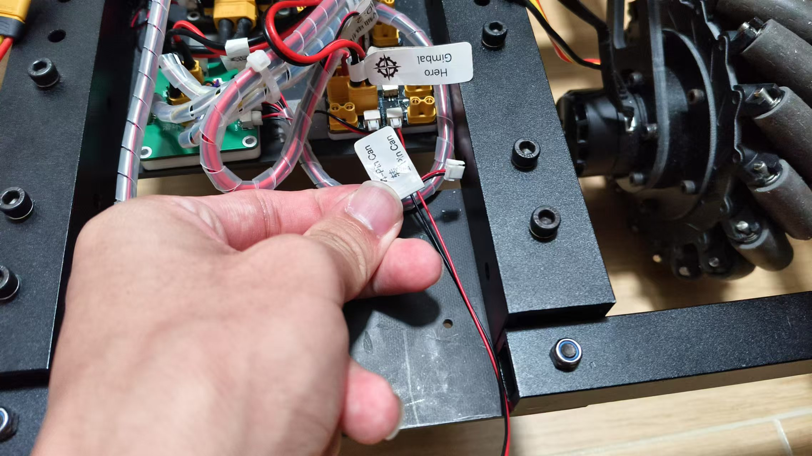
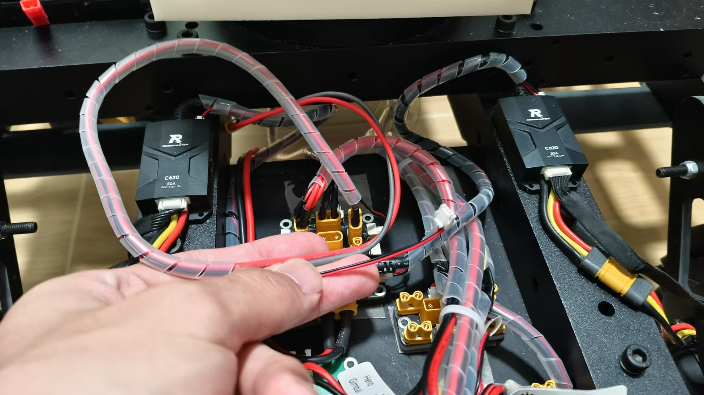
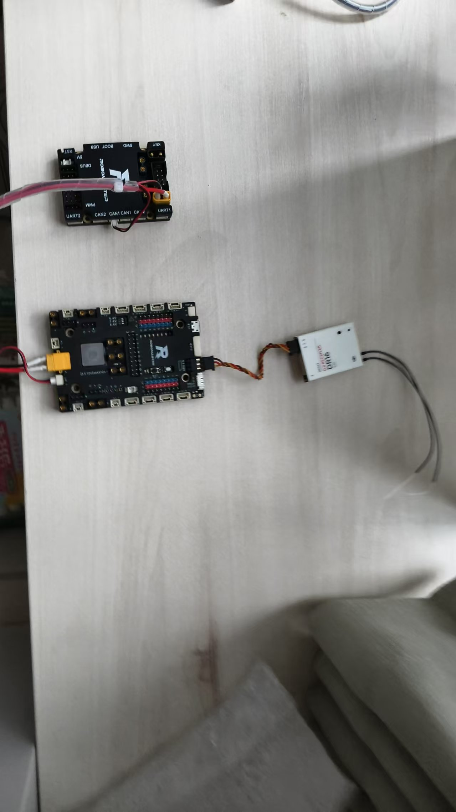

# ~~某台垃圾步兵~~

## 程序指南

~~本程序为步兵的云台程序，底盘程序直接使用 `example_chassis_DJI_Board_TypeC_general_can_bridge`。~~
### 项目目录结构如下：
```bash
前面省略...
可以看 RM_UIC_FILE_README.md 观看完整程序目录结构

include [为库的头文件]
src [为程序的源文件]
CMakeLists [为CMake编译配置文件]

重点目录如下：
~(QWQ~)
├─Module_test (云台测试程序zzy爆改版)
│  └─gimbal (云台程序)
│      ├─include
│      └─src
├─openocd (下载器配置文件)
│  ├─stm32f1
│  ├─stm32f4
│  └─stm32h7
└─programs
    └─DGStandard
        ├─chassis (底盘程序)
        │  ├─include
        │  └─src
        └─gimbal (云台程序)
            ├─include
            └─src
```

## 接线相关

### 云台接口定义
<font size="4">
云台上开发板是一块 RoboMaster 开发板A，使用的电机如下：
- 开发板A的CAN(ID)为： 0x51
- 云台与底盘通信： can1+开发板A(ID) 总线通信(主机)
- pitch电机：GM6020 ~~can2+0x20A 电流控制模式~~ can2+0x205 电流控制模式
- yaw电机：GM6020 ~~can1+0x209 电流控制模式~~ can2+0x206 电流控制模式
- 拨弹电机：M2006 ~~can1+0x203 使用老的ServoMotor类~~ can2+0x203 使用老的ServoMotor类
- 摩擦轮电机：M2305 ~~PWM 定时器1+定时器6+通道1/通道4~~ can2+0x201+0x202 使用老的ServoMotor类

使用的其他接口如下：
- UART8：调试接口
- UART6：~~外置IMU~~后续更换为mini-PC对接接口
- UART1：D-Bus接收机
- UART3：裁判系统串口
- UART7：图传串口，用于接收图传数据

</b>

### 底盘接口定义
<font size="4">云台上开发板是一块 RoboMaster 开发板C，使用的电机如下：
- 开发板C的CAN(ID)为： 0x52
- 云台与底盘通信： can1+开发板C(ID) 总线通信(从机)
- 麦轮底盘：通过 ~~Can Bridge~~  can2+0x201->0x204 连接控制4个底盘3508电机

</b>

### 模式控制(待调试)

- 射击模式控制：
- shoot_flywheel_mode：设置PREPARING/STOP控制摩擦轮启停，就绪后由shoot_task转为PREPARED 
- shoot_load_mode：设置SINGLE/BURST/STOP切换发射模式（供弹模式）

### *实际接线图

#### 云台(A板)电机(can2通信)接线示意图
- <font size="4">__云台与底盘通信：can1通信，本机ID为0x51 ~~(待调试)~~__
- <font size="4">__pitch电机：GM6020 can2+0x205 电流控制模式__
- <font size="4">__yaw电机：GM6020 can2+0x206 电流控制模式__
- <font size="4">__拨弹电机：M2006 can2+0x203 使用老的ServoMotor类__
- <font size="4">__摩擦轮电机：M2305 can2+0x201+0x202 使用老的ServoMotor类


</b>

#### 底盘(C板)电机(can2通信)接线示意图

- <font size="4">__底盘与云台通信：can1通信，本机ID为0x52 ~~(待调试)~~__
- <font size="4">__配置4个底盘电机为can2通信，ID为0x201->0x204 (待调试)__


</b>

#### 云台(A板) & 底盘(C板) 接线示意图
- <font size="4">__底盘与云台通信：can1通信 ~~(待调试)~~__
- __A板：can1 的ID为0x51 ~~(待调试)~~__
- __C板：can1 的ID为0x52 ~~(待调试)~~__
- __D-Bus接收机：A板 UART1 串口通信 ~~(待调试)~~__
</b>

